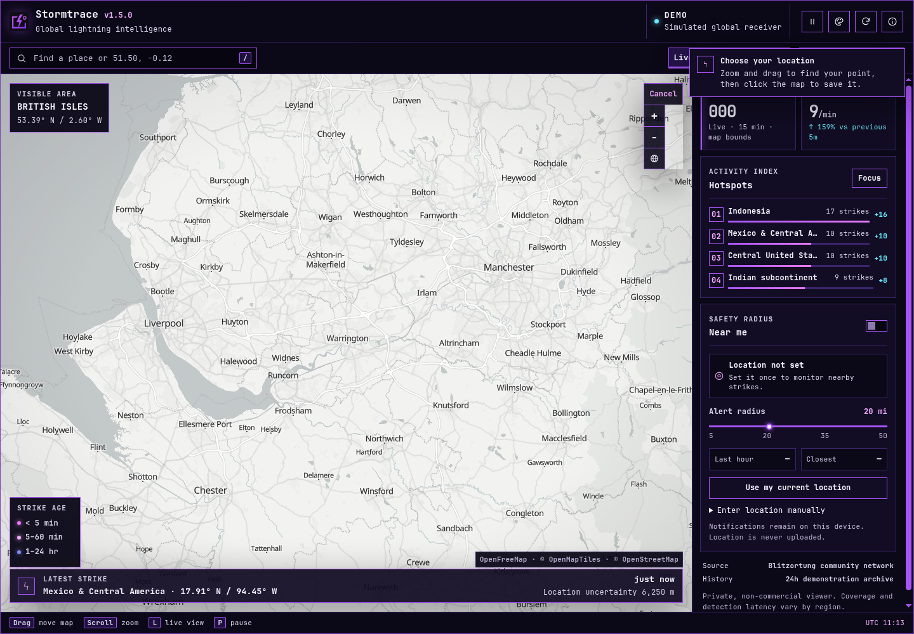
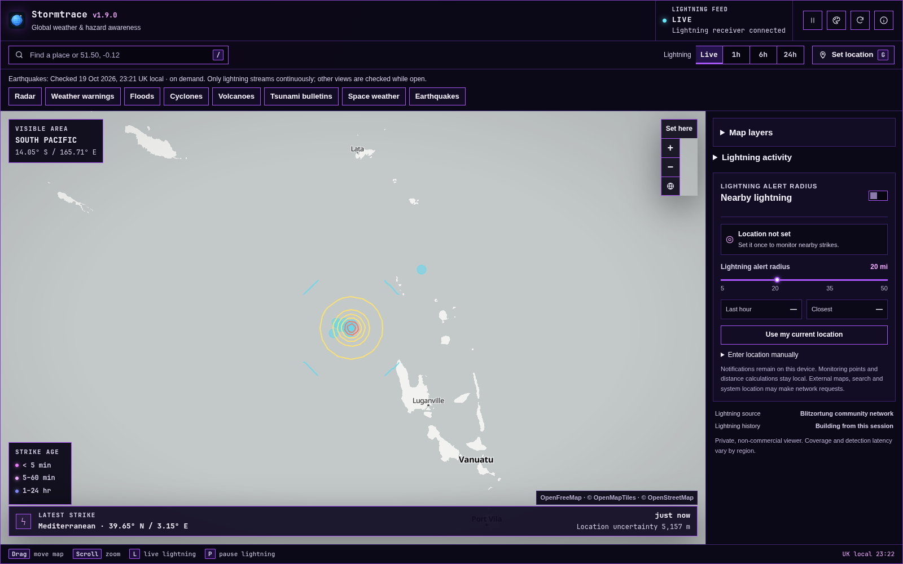

# Stormtrace

**Weather and hazard monitoring, built for Omarchy.**

Stormtrace is a desktop viewer for live lightning, with private alerts when lightning strikes near you. It also brings together radar, UK weather warnings, flood information, recent earthquakes, cyclones, volcanic activity, tsunami bulletins and space weather, all from official or public sources, in one window.


> Lightning screenshots use the built-in demo feed and may show an earlier layout. Hazard screenshots show live data captured on 19 October 2026.

## What it does

- **Live lightning map.** Strikes appear as they are detected, coloured by age. Choose the live view, the past hour, six hours or the last 24 hours.
- **Strike details.** Detection time, coordinates, location uncertainty, polarity where available, and distance from your monitoring point.
- **Activity at a glance.** Visible strike totals, feed rate, ranked hotspots and the latest strike.
- **Private nearby alerts.** A desktop notification when lightning strikes within 5 to 50 miles of your monitoring point, at most once every two minutes.
- **Radar.** Rainfall for the UK and Europe, and radar reflectivity and precipitation type (rain, snow, hail) for the US, with recent frames to step through.
- **UK weather warnings.** Met Office warnings with official colours. Public summaries need no setup; full details need a free key.
- **Floods.** Live Environment Agency warnings for England, and official links for Wales, Scotland and Northern Ireland.
- **Earthquakes.** The past day of USGS earthquakes, with filters and optional shaking contours on the map.
- **Cyclones, volcanoes, tsunami bulletins and space weather.** Official summaries with links to the source agencies.
- **Clear source status.** Every view shows when it last checked its source, and whether the data is cached, delayed or unavailable.
- **Feels native.** A contained GTK window with one-click fullscreen, a single instance, and colours that follow your Omarchy theme.

Stormtrace is for situational awareness. It is not a safety-critical warning system; always follow official guidance.

## Install

Install the native runtime once:

```bash
omarchy pkg add python-gobject gtk3 webkit2gtk-4.1 geoclue
```

Add and enable Stormtrace:

```bash
omarchy plugin add https://github.com/Ashcutus/Stormtrace.git --enable
```

The Stormtrace icon appears on the right of the bar. Select it to open Stormtrace; selecting it again focuses the existing window.

To also open Stormtrace from the app launcher (`SUPER + SPACE`):

```bash
~/.config/omarchy/plugins/stormtrace.lightning/install-omarchy.sh
```

The plugin needs no `sudo` and does not run at boot. Its local service starts when you open Stormtrace and stops when you exit.

## Using Stormtrace

### Lightning

Select the leading hotspot to jump from the world view to the most active region.


Hover over a strike for a quick summary. Select it to keep its details open while new strikes arrive, and select it again or use the close button to dismiss them.


### Your monitoring point and alerts

Distances and nearby alerts are measured from your monitoring point. All location controls are in **Your location** under **Nearby lightning** in the sidebar (the toolbar **Set location** button, or `G`, also requests your position): **Locate me** requests your current position, **Pick on map** lets you click the map to choose a point, and **Enter coordinates** accepts latitude and longitude. Press `Escape` or **Cancel picking** to leave your saved point unchanged. **Desktop alerts** turns nearby-lightning notifications on or off.

If only a rough position (accurate to more than 5 km) is available, Stormtrace shows its coordinates and uncertainty so you can decide whether to use it. Wired (Ethernet) connections are supported.




### Hazard views

Open a view from the **Hazards** buttons in the toolbar. Each one checks its source only while it is open, shows when it last checked, and links to the official source. A small dot on each button shows its last check: cyan for checked, yellow for checking or cached, red for a failed retrieval.

| View | Source | Needs setup? | Guide |
| --- | --- | --- | --- |
| Weather warnings | Met Office | No for summaries; a free key for full details | [Weather warnings](docs/warnings.md) |
| Floods | Environment Agency (England) | No | [Floods](docs/floods.md) |
| Cyclones, Volcanoes, Tsunami bulletins, Space weather | NOAA, USGS, Smithsonian | No | [Other hazards](docs/hazards.md) |
| Earthquakes | USGS | No | [Earthquakes](docs/earthquakes.md) |

Most views have a **Current** list and a **Saved history** list. Saved history contains what Stormtrace has seen on this device while the view was open; it is not a complete archive.

**Layers**, at the top left of the map, controls everything drawn on the main map: lightning strikes, radar, England flood warning areas and past-day earthquakes. Selecting an earthquake loads its official USGS shaking contours where they exist. **Show on map** in the Floods, Earthquakes and Cyclones lists highlights one event; it appears as **Selected** in Layers, with **Clear** to remove it. See [map layers](docs/map-hazards.md).



Live radar and hazard data are turned off in demo mode.

### Weather warnings

Weather warnings work straight away using the public Met Office summaries. For full warning text, affected areas, validity times, history and a highlight when your monitoring point is affected, add a free Weather DataHub key to the installed app's `.env`:

```dotenv
METOFFICE_WARNINGS_API_KEY=your_subscription_key
```

Then exit and reopen Stormtrace. The [warnings guide](docs/warnings.md#setup) explains how to get a key.


**Warning map** in the warnings view shows current warning areas on a separate UK map, with no key needed.


### Radar

Select **Radar** in the toolbar (or tick it in **Layers** on the map), then choose a **Source / region** in the radar panel that opens in the sidebar. US radar works with the standard runtime. UK and European rainfall need an [optional decoder](docs/radar.md#setup), which takes a few commands to set up. No radar account or key is needed.


UK and European frames arrive every 15 minutes (Met Office publication can lag by up to 20 minutes). US frames update about every two minutes. US radar shows reflectivity in dBZ, while UK and Europe show rainfall rate in mm/h; these are different measurements. Clear areas can mean no rain or no radar coverage.
US **precipitation type** shows NOAA's rain, snow and hail classification for the same US regions. It is model-assisted and has no sleet or freezing-rain category. Precipitation type is not published for UK or European radar, so it is US-only for now.

### Appearance

Stormtrace follows the active Omarchy theme automatically, or you can save your own colour scheme. The **Appearance** panel also sets reading size, whether times show in UK local time or your device's time zone (Met Office warnings always use UK local time), and map brightness, opacity and edge shading. Strike-age colours (yellow, orange, crimson) and official warning colours stay fixed in every theme. The map has English place names where available. It needs WebGL; without it, Stormtrace falls back to standard OpenStreetMap tiles.


## Controls

| Control | What it does |
| --- | --- |
| `Live` / `1h` / `6h` / `24h` | Change the lightning window. |
| `Focus top` | Move to the leading hotspot. |
| Drag / scroll | Move or zoom the map. |
| `Layers` | Show or hide lightning strikes, radar, flood areas and earthquakes, or clear a selected event. Hiding strikes keeps collection and alerts running. |
| `Set location` | Request your current position (up to 30 seconds), from the toolbar. |
| `Locate me` | Request your current position (up to 30 seconds). |
| `Pick on map` | Choose a monitoring point by clicking the map. |
| `Desktop alerts` | Turn nearby-lightning notifications on or off. |
| Alert radius | Set the alert distance, from 5 to 50 miles. |
| Pause / play | Pause or resume the lightning stream. Other views refresh independently. |
| Reconnect (plug) | Reconnect the lightning stream. |
| Expand / restore | Switch between the window and fullscreen. |
| About | Read data notes and check for a newer version. |
| Power | Exit Stormtrace and stop its local service. |

### Keyboard shortcuts

| Key | Action |
| --- | --- |
| `/` | Search for a place or coordinates. |
| `L` | Switch to the Live lightning window. |
| `G` | Locate me (request or update your location). |
| `N` | Turn desktop alerts on or off. |
| `P` | Pause or resume lightning. |
| `R` | Reconnect the lightning stream. |
| `+` / `−` | Zoom the map. |
| `Escape` | Close a dialog or cancel picking a monitoring point. |
| `?` | Show all keyboard shortcuts. |
| `F11` | Toggle fullscreen. |
| `Ctrl+Q` | Exit Stormtrace. |

Shortcuts are paused while a dialog is open or you are typing. On narrow windows, **Map** and **Lightning & location** tabs switch between the map and the sidebar.

## Privacy

- Your monitoring point, alert settings, appearance settings and lightning history stay on your device.
- Distances and alerts are calculated locally. Stormtrace does not send your monitoring point to any hazard source.
- The map downloads tiles from OpenFreeMap or OpenStreetMap, place searches go to OpenStreetMap Nominatim, and automatic location uses your system's location service.
- The lightning archive covers up to 24 hours and 30,000 strikes.
- The local server only listens on `127.0.0.1` and stops when you exit.

## Data sources and limitations

Live lightning comes from the unofficial LightningMaps/Blitzortung community feed. Coverage, delay and availability vary by region. Blitzortung data is for private, non-commercial use only. Stormtrace reconnects automatically if the feed drops.

A new installation builds its lightning history while it runs. To load earlier history, add a `LIGHTNING_API_KEY` to `.env` (copy `.env.example` to start) and restart Stormtrace. The key stays on the local server, and your plan must cover the history you request.

Each hazard source has its own coverage and limits, which its guide describes. Data is delivered over the internet on a best-effort basis. For decisions about your safety, use the official source and your local authorities.

- [Blitzortung project and data-use guidance](https://www.blitzortung.org/en/compendium.php)
- [LightningMaps documentation](https://docs.lightningmaps.org/)
- [Optional Lightning API documentation](https://lightningapi.dev/docs)
- [OpenStreetMap copyright](https://www.openstreetmap.org/copyright)

## Update or remove

To check for a new version, open **About Stormtrace and updates** and select **Check for updates**. Stormtrace only checks; it never downloads or installs anything by itself.

Update:

```bash
omarchy plugin update stormtrace.lightning --yes
```

Close and reopen Stormtrace afterwards to load the new version.

Remove:

```bash
~/.config/omarchy/plugins/stormtrace.lightning/uninstall-omarchy.sh
omarchy plugin remove stormtrace.lightning
```

## Troubleshooting

**Stormtrace does not open.** Check the local service and native runtime:

```bash
curl http://127.0.0.1:4177/api/health
systemctl --user status stormtrace-receiver.service
journalctl --user -u stormtrace-receiver.service
python3 -c 'import gi; gi.require_version("Gtk", "3.0"); gi.require_version("WebKit2", "4.1"); from gi.repository import Gtk, WebKit2'
```

If a crash left the service running, stop it with:

```bash
~/.config/omarchy/plugins/stormtrace.lightning/start-app.sh --stop
```

**The map is blank or strikes are missing.** The map and lightning feed need network access. Press `R` or use the refresh button to reconnect. Demo mode (below) confirms the interface itself works.

**Older time windows are empty.** The 24-hour archive starts filling when Stormtrace first runs. Earlier history needs the optional Lightning API key described above.

**Theme colours don't update.** Choose **Omarchy** in Appearance. Stormtrace checks for theme changes every five seconds and when the window regains focus.

**Radar says the decoder isn't configured.** See [radar troubleshooting](docs/radar.md#troubleshooting).

## For contributors

Stormtrace has no npm runtime dependencies. Node.js 20+ runs the local server when available, with Python 3 as a fallback.

```bash
./start.sh        # start the local server
./start-app.sh    # open the native window
```

For a walkthrough without live data, open `http://127.0.0.1:4177/?demo=1`.

Before committing, run:

```bash
npm ci
npm run check
npm test
bash -n start.sh start-app.sh install-omarchy.sh uninstall-omarchy.sh
git diff --check
omarchy plugin validate .
```

The tests are deterministic and need neither a desktop session nor live feeds, so they don't replace a manual check in the real desktop.

Start with the [documentation index](docs/README.md), then the [architecture guide](docs/architecture.md) and [provider guide](docs/providers.md). Optional [soak diagnostics](docs/diagnostics.md) are available for long-running tests. Releases follow the [publishing checklist](PUBLISHING.md).

## Licence

Stormtrace is released under the [MIT Licence](LICENSE). Lightning data remains subject to the source network's private, non-commercial terms.
