<p align="center">
  
</p>

<h1 align="center">Stormtrace</h1>

<p align="center">
  <strong>Live lightning, radar and world hazards in one calm window. Built for Omarchy.</strong>
</p>

<p align="center">
  <a href="manifest.json"></a>
  <a href="LICENSE"></a>
  
</p>

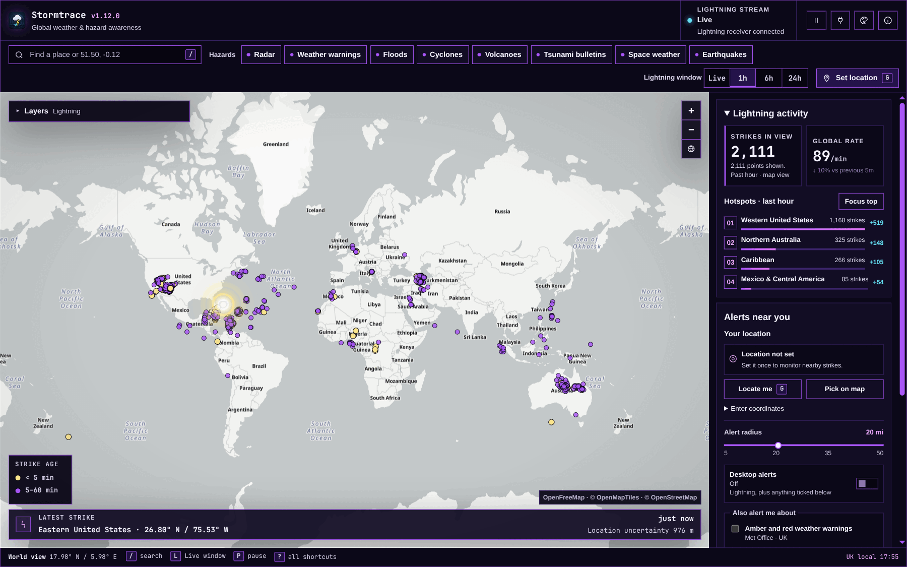

Watch thunderstorms light up the map as strikes are detected around the world, and get a quiet desktop alert if lightning comes close to you. When you want the bigger picture, one click brings up rain radar, UK weather warnings, floods, earthquakes, tropical cyclones, volcanoes, tsunami bulletins and space weather, all straight from official and public sources.

Your location stays on your computer. There's no account, no cloud service and nothing running in the background when Stormtrace is closed.

> Stormtrace is for keeping an eye on the weather, not a safety warning system. Always follow official guidance.

## What you can do with it

### ⚡ Follow lightning as it happens

New strikes appear within moments, coloured by age: bright yellow for the last five minutes, orange for the last hour, crimson for older ones. Switch between the live view and the last hour, six hours or 24 hours, and jump straight to the busiest storm with **Focus top**.

<table>
  <tr>
    <td width="50%">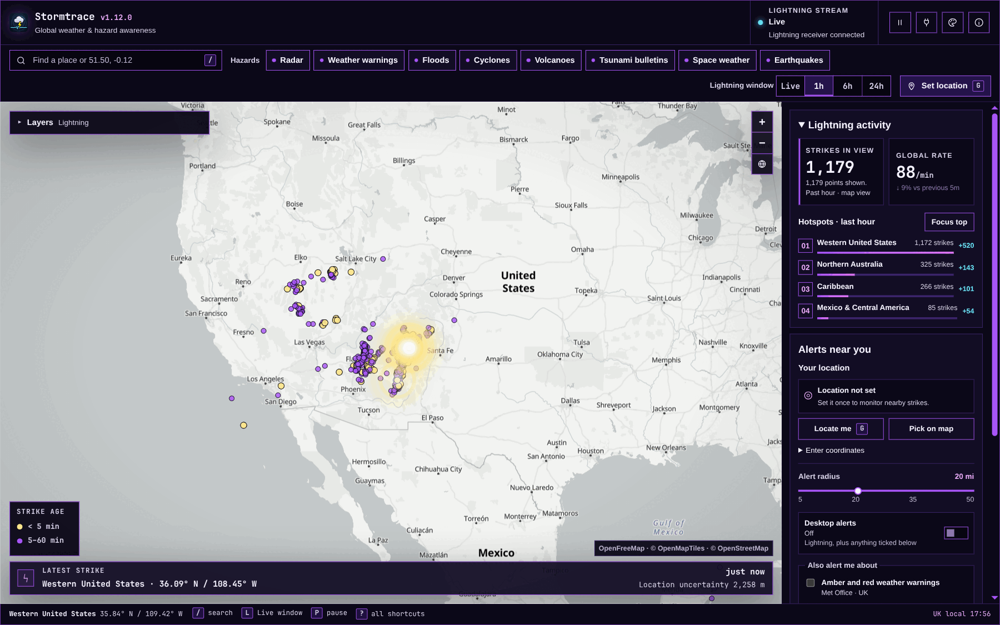</td>
    <td width="50%">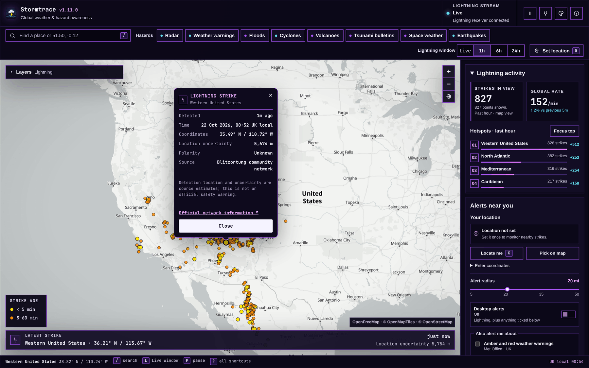</td>
  </tr>
  <tr>
    <td align="center"><sub>Zoom straight into the busiest storm</sub></td>
    <td align="center"><sub>Every strike has its own details</sub></td>
  </tr>
</table>

### 🔔 Know when it's getting close

Set your location once, choose an alert radius between 5 and 50 miles, and turn on **Desktop alerts**. Stormtrace will let you know when lightning strikes inside that circle, at most once every two minutes. The sidebar keeps a running count and shows how far away the closest strike was.

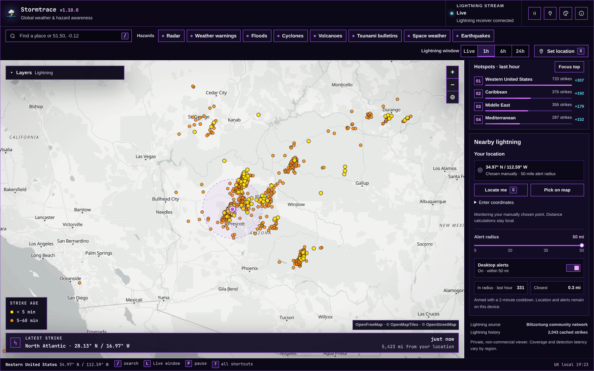

### 🌧️ See the rain

Turn on **Radar** to see the last three hours of rainfall for the UK and Europe, or radar reflectivity for the US, and scrub back through the frames. In the US you can also switch to **precipitation type** to tell rain, snow and hail apart.

<table>
  <tr>
    <td width="50%">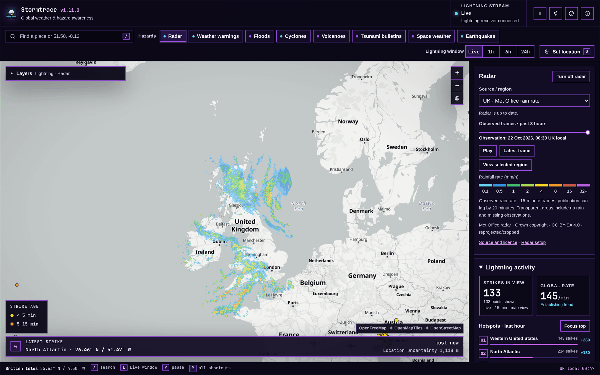</td>
    <td width="50%">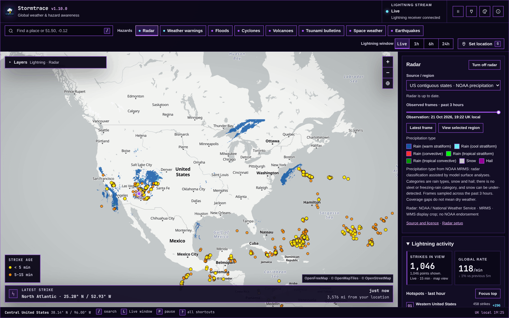</td>
  </tr>
  <tr>
    <td align="center"><sub>UK rainfall from the Met Office</sub></td>
    <td align="center"><sub>US rain, snow and hail from NOAA</sub></td>
  </tr>
</table>

### 🌍 Keep an eye on the wider world

The **Hazards** buttons along the top open each view. A small dot on each button shows how its last check went: cyan for up to date, yellow while checking or showing saved data, red if the source couldn't be reached.

| View | What you'll see | Source |
| --- | --- | --- |
| **Weather warnings** | UK warnings in the official yellow, amber and red, plus a dedicated warning map | Met Office |
| **Floods** | Live flood alerts and warnings for England, with links for Wales, Scotland and Northern Ireland | Environment Agency |
| **Earthquakes** | The past day of earthquakes worldwide, with estimated shaking where USGS publishes it | USGS |
| **Cyclones** | Active tropical storms in the Atlantic and eastern and central Pacific | NOAA NHC |
| **Volcanoes** | US volcano alerts and weekly global activity reports | USGS, Smithsonian |
| **Tsunami bulletins** | The latest bulletins from the US tsunami warning centres | NOAA |
| **Space weather** | Current conditions, forecasts and recent alerts | NOAA SWPC |

<table>
  <tr>
    <td width="50%">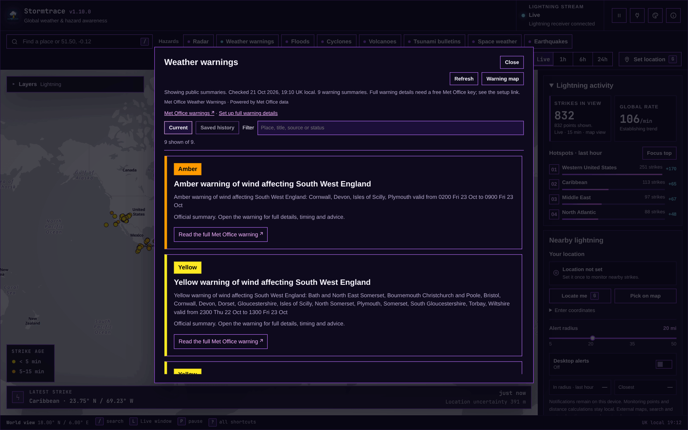</td>
    <td width="50%">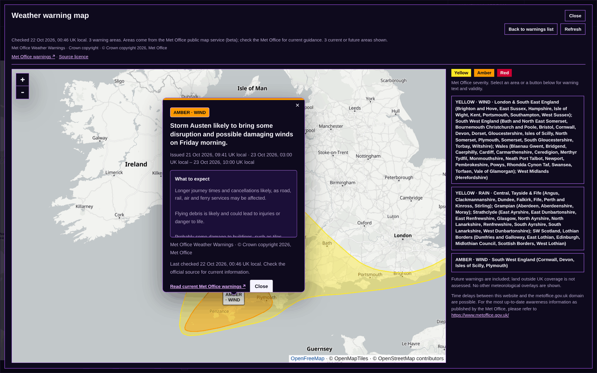</td>
  </tr>
  <tr>
    <td align="center"><sub>UK warnings in their official colours</sub></td>
    <td align="center"><sub>See exactly where each warning applies</sub></td>
  </tr>
  <tr>
    <td width="50%">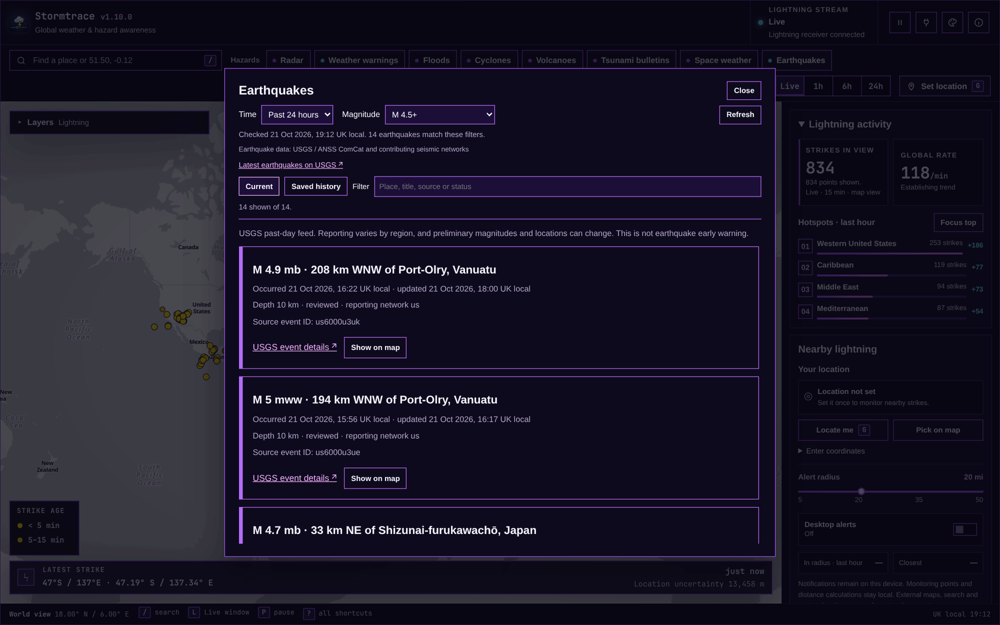</td>
    <td width="50%">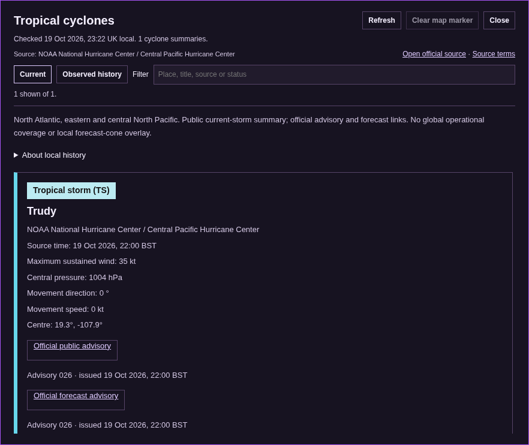</td>
  </tr>
  <tr>
    <td align="center"><sub>Filter earthquakes by time and size</sub></td>
    <td align="center"><sub>Follow active tropical storms</sub></td>
  </tr>
</table>

Use **Layers** in the top-left corner of the map to add flood areas or earthquakes to the map itself, and **Show on map** in a list to jump to one event. Every view says where its information comes from, when it last checked, and whether anything is delayed or unavailable.

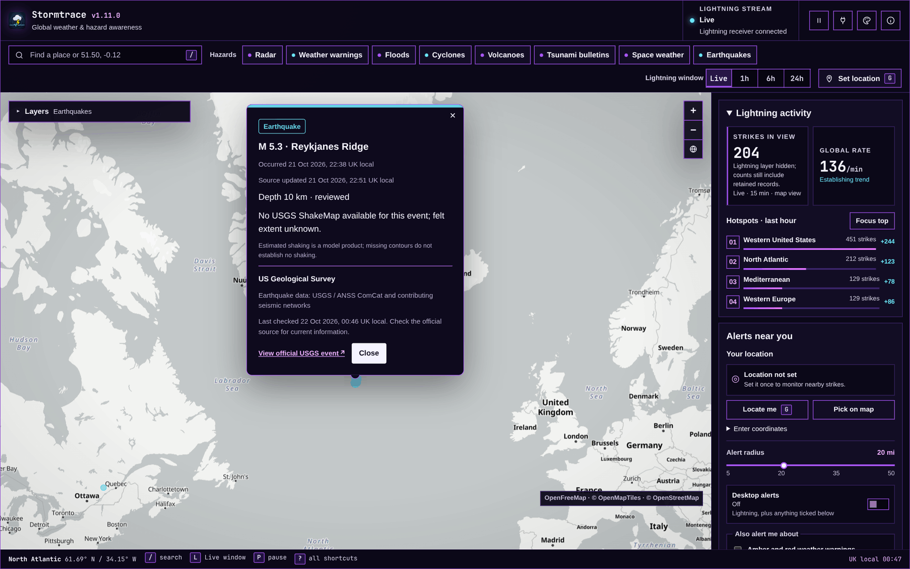

### 🎨 Make it yours

Stormtrace follows your Omarchy theme automatically, or you can pick your own colours. **Appearance** also has larger text sizes, a choice of UK or local time, and map brightness and shading. Strike colours and official warning colours never change, so they always mean the same thing.

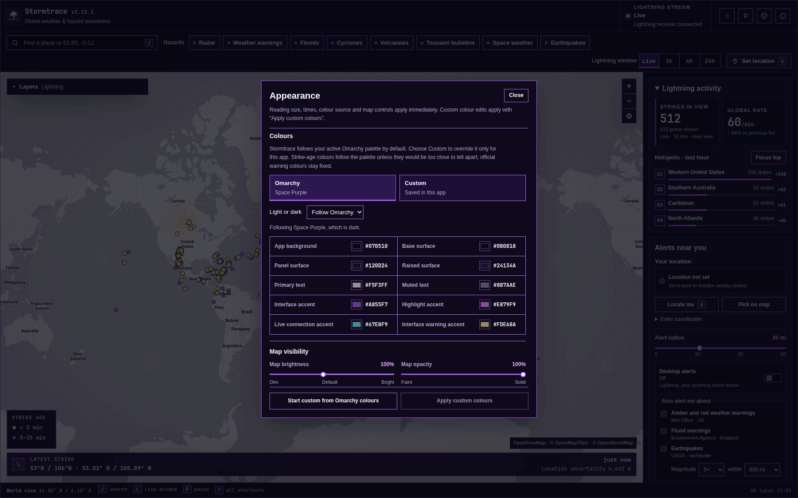

<sub>Screenshots show live data captured on 21 October 2026.</sub>

## Install

Stormtrace runs as an Omarchy plugin. First install the native runtime:

```bash
omarchy pkg add python-gobject gtk3 webkit2gtk-4.1 geoclue
```

Then add and enable Stormtrace:

```bash
omarchy plugin add https://github.com/Ashcutus/Stormtrace.git --enable
```

A storm icon appears on the right of your bar. Click it to open Stormtrace; click it again to bring the window back to the front.

Want it in the app launcher (`SUPER + SPACE`) too? Run:

```bash
~/.config/omarchy/plugins/stormtrace.lightning/install-omarchy.sh
```

No `sudo` is needed, and nothing runs at boot. The small local service starts when you open Stormtrace and stops when you close it.

## Getting started

1. **Set your location.** Click **Set location** in the toolbar (or press `G`). On a wired connection, or if you'd rather not share your position, use **Pick on map** or **Enter coordinates** in the sidebar instead. If only a rough position is available, Stormtrace shows how rough it is and lets you decide.
2. **Choose your alert radius** and turn on **Desktop alerts**.
3. **Explore.** Try the **Hazards** buttons, turn on **Radar**, or press `?` to see every keyboard shortcut.

### Weather warnings: full details

Weather warnings work straight away using the Met Office's public summaries. For the full warning text, affected areas, validity times, saved history and a highlight when your location is inside a warning, add a free Met Office Weather DataHub key to the app's `.env`:

```dotenv
METOFFICE_WARNINGS_API_KEY=your_subscription_key
```

Restart Stormtrace afterwards. The [warnings guide](docs/warnings.md#setup) walks you through getting a key.

### Radar: UK and Europe

US radar works out of the box. UK and European rainfall need a small [optional decoder](docs/radar.md#setup), which takes a few commands to set up. No radar account or key is needed.

UK and European frames arrive every 15 minutes (the Met Office can be up to 20 minutes behind), and US frames about every two minutes. US radar shows reflectivity (dBZ) while the UK and Europe show rainfall rate (mm/h), so their colours mean different things. A clear patch can mean dry weather or simply no radar coverage.

US precipitation type is a NOAA classification that uses weather models as well as radar. It has no category for sleet or freezing rain, and it can miss some snow. The UK and Europe don't publish precipitation type yet.

## Keyboard shortcuts

| Key | What it does |
| --- | --- |
| `/` | Search for a place or coordinates |
| `L` | Switch to the live lightning view |
| `G` | Find my location |
| `N` | Turn desktop alerts on or off |
| `P` | Pause or resume lightning |
| `R` | Reconnect the lightning feed |
| `+` / `−` | Zoom the map |
| `Esc` | Close a dialog, or stop picking a point on the map |
| `?` | Show all shortcuts |
| `F11` | Toggle fullscreen |
| `Ctrl+Q` | Quit Stormtrace |

Shortcuts pause while a dialog is open or you're typing. On narrow windows, the **Map** and **Lightning & location** tabs switch between the map and the sidebar.

## Your privacy

- Your location, alert settings, appearance and lightning history stay on your computer.
- Distances and alerts are worked out locally. Your location is never sent to any hazard source.
- The map downloads tiles from OpenFreeMap or OpenStreetMap, place searches go to OpenStreetMap Nominatim, and automatic location uses your system's location service.
- The lightning archive keeps up to 24 hours and 30,000 strikes.
- The local service only listens on `127.0.0.1` and stops when you quit.

## Where the data comes from

Live lightning comes from the LightningMaps/Blitzortung community network. It's an unofficial, volunteer-run feed, so coverage and delay vary from place to place, and its data is for private, non-commercial use only. Stormtrace reconnects automatically if the feed drops.

A new install builds up its lightning history as it runs. To load earlier history, add a `LIGHTNING_API_KEY` to `.env` (copy `.env.example` to start) and restart. The key stays on your local server, and your plan needs to cover the history you ask for.

Every other source has its own coverage and limits, explained in its guide. Everything arrives over the internet on a best-effort basis, so for decisions about your safety, check the official source and your local authorities.

- [Blitzortung project and data-use guidance](https://www.blitzortung.org/en/compendium.php)
- [LightningMaps documentation](https://docs.lightningmaps.org/)
- [Optional Lightning API documentation](https://lightningapi.dev/docs)
- [OpenStreetMap copyright](https://www.openstreetmap.org/copyright)

## Updating and removing

To see whether there's a new version, open **About** and select **Check for updates**. Stormtrace only checks; it never downloads or installs anything by itself.

To update:

```bash
omarchy plugin update stormtrace.lightning --yes
```

Then close and reopen Stormtrace.

To remove it:

```bash
~/.config/omarchy/plugins/stormtrace.lightning/uninstall-omarchy.sh
omarchy plugin remove stormtrace.lightning
```

## Troubleshooting

**Stormtrace won't open.** Check the local service and native runtime:

```bash
curl http://127.0.0.1:4177/api/health
systemctl --user status stormtrace-receiver.service
journalctl --user -u stormtrace-receiver.service
python3 -c 'import gi; gi.require_version("Gtk", "3.0"); gi.require_version("WebKit2", "4.1"); from gi.repository import Gtk, WebKit2'
```

If a crash left the service running, stop it with:

```bash
~/.config/omarchy/plugins/stormtrace.lightning/start-app.sh --stop
```

**The map is blank or there are no strikes.** The map and lightning feed need a network connection. Press `R` to reconnect. The demo (see below) is a quick way to check the app itself is working.

**The longer time windows are empty.** The 24-hour archive starts filling the first time you run Stormtrace. Earlier history needs the optional Lightning API key described above.

**Theme colours don't update.** Choose **Omarchy** in Appearance. Stormtrace checks for theme changes every five seconds and whenever the window regains focus.

**Radar says it needs setting up.** See [radar troubleshooting](docs/radar.md#troubleshooting).

## Contributing

Stormtrace has no npm runtime dependencies. Node.js 20+ runs the local server when it's available, with Python 3 as a fallback.

```bash
./start.sh        # start the local server
./start-app.sh    # open the native window
```

To try it without live data, open `http://127.0.0.1:4177/?demo=1`. The demo uses simulated lightning and turns off radar and other live sources.

Before committing, run:

```bash
npm ci
npm run check
npm test
bash -n start.sh start-app.sh install-omarchy.sh uninstall-omarchy.sh
git diff --check
omarchy plugin validate .
```

The tests are deterministic and need neither a desktop session nor live feeds, so they don't replace trying it in the real desktop.

Start with the [documentation index](docs/README.md), then the [architecture guide](docs/architecture.md) and [provider guide](docs/providers.md). There are optional [soak diagnostics](docs/diagnostics.md) for long-running tests, and releases follow the [publishing checklist](PUBLISHING.md).

## Licence

Stormtrace is released under the [MIT Licence](LICENSE). Lightning data remains subject to the source network's private, non-commercial terms.
