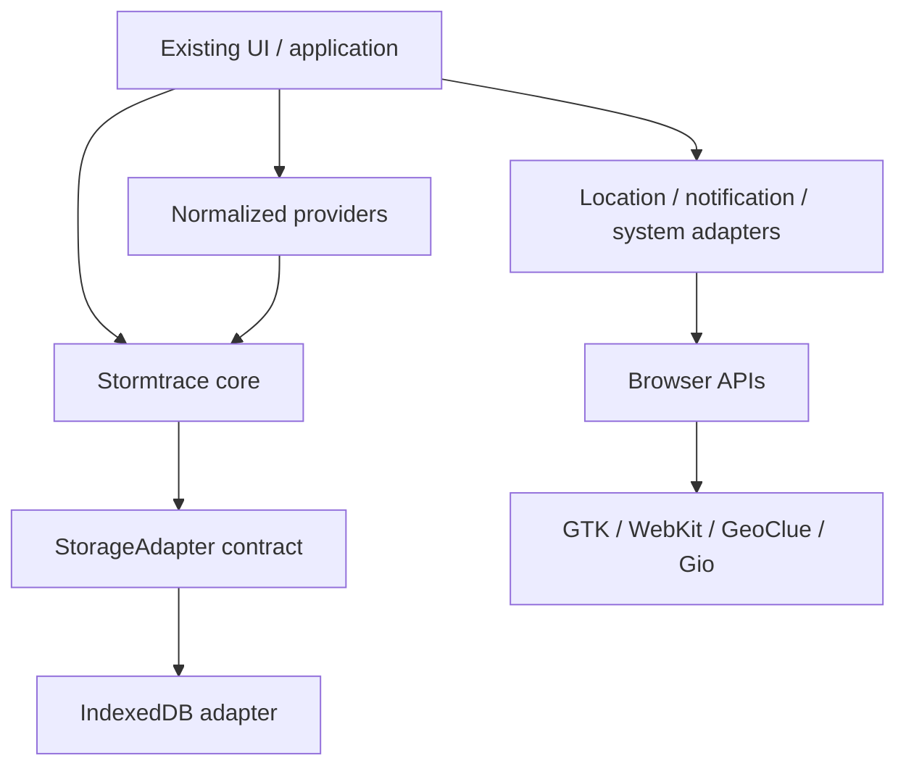

# Stormtrace architecture

This guide describes the current code boundaries and compatibility rules.

## Boundaries

Architecture rules:

- **No platform API above the platform-adapter boundary.** Composition roots may choose adapters and configure transport; core and hazard providers never invoke Linux APIs or choose filesystem paths.
- **No UI component should understand an upstream provider API format.** UI consumes normalized strike/place/event/measurement/frame models. Transport lifecycle can remain application-managed during incremental extraction.
- **Provider-native severity/classification must be preserved.** Display priority is a separate internal ordering/prominence concept, never an authoritative danger score.

`core/model.js`, `geometry.js`, `history.js`, `xml.js` and `cap.js` run in a browser or Node without platform imports. They expose `StormtraceCore` to V1's classic scripts. `core/index.js` is the Node entry point for the same implementations. `core/contracts.d.ts` documents the JavaScript contracts; this is not a TypeScript migration or a compiled runtime validation system. Browser script order is explicit in `index.html`.

`providers/` owns upstream formats, normalization, metadata and structured retrieval failures. `platform/browser.js` implements location, neutral notification intents, settings and atomic revision storage; `platform/strike-cache.js` retains V1 cache mechanics. `platform/node.js` and `stormtrace_platform.py` implement theme/key/profile/native-notification mechanisms. The GTK shell, launch scripts and bar widget are themselves Linux system-integration adapters and remain Linux-specific. No speculative Windows/macOS implementation is included.

## Events, provenance and domain data

`StormtraceEvent<K, P, S>` retains identity, kind, provider, authority, observation/update/validity times, GeoJSON geometry, native severity, display priority, provenance and a domain payload. All times are UTC epoch milliseconds, nullable when not supplied. Event construction validates required identity relationships, priority, timestamps and geometry. Source-native values can be strings or structured values (magnitude/status, G/R/S scales, official classifications).

Payload contracts cover warnings, earthquakes, cyclone tracks/forecasts/cones, volcanoes, tsunamis, lightning and linked space-weather events. Radar uses frame resources and bounds; space weather has distinct current measurements, time series and event capabilities. These are not coerced into discrete events. History accepts event envelopes; a future measurement/frame archive can use the same atomic storage contract with its own record model.

Provenance contains provider, source authority/URL, upstream ID, fetch time, source observation/update times and named transformations. `provenanceFreshness` resolves expected cadence from the source registry. Unknown source times stay null. The legacy live display fallback for a missing strike time remains fetch time, explicitly marked `time-inferred-from-fetch` while source observation time stays null. Legacy strikes remain valid cache records; no fetch time or authority is fabricated for them. New live and backfill records retain provenance through application normalization and cache reloads. Python backfill returns its actual fetch time; the browser provider resolves authority from the same canonical registry.

## History and retention

`RevisionHistory` uses `StorageAdapter.get/update/entries`. `update` is an atomic synchronous read-modify-write callback; returning null deletes a row. The IndexedDB adapter fulfills that contract with one readwrite transaction. Enumeration uses bounded bulk key/value reads in one readonly transaction, relying on IndexedDB structured clones for detached snapshots; it avoids a cursor callback per row. Retention skips unchanged and unrelated rows before opening write transactions, and rechecks eligible changes atomically. The memory adapter is for deterministic tests, not production fallback pretending to be durable.

The separate IndexedDB database `stormtrace-revisions`, version 1, contains an `events` store. Keys encode `[provider, eventId]`. Each event row holds ordered immutable revision snapshots with sequence and persistence time. Each snapshot retains all source timestamps and provenance. Duplicate latest content is compared using exact canonical serialization with stable object key order; fetch time alone is excluded. This avoids hash collisions and duplicate fetch snapshots. Changes to source update time, severity, geometry or domain content produce a revision, as does a later reversion to earlier content. Original fetch time stays attached to the revision that was actually persisted; provider health tracks repeated successful fetches separately.

`revisions(provider, id)` queries one event; `query({from,to,provider,time})` returns matching revisions by observation, update, fetch or persistence time. Queries currently scan bounded local rows; they are not a distributed event store. `retain({before,keepLatest,provider,maxEvents})` explicitly selects a persistence-time cutoff and optionally preserves each latest revision. Policies are caller-owned. An optional event-count budget evicts the oldest persisted event rows, without deleting a row changed during selection. V1 invokes a 24-hour/30,000-event budget per source only for its two lightning sources, never for future warnings. Revision persistence is best effort if browser storage is unavailable; failures are logged and the live receiver continues.

No existing settings/schema migration is required: both the settings key and V1 database/schema remain unchanged. Creating the independent revision database is additive and idempotent. Old installations can open their original strike database without a downgrade or conversion. New records carry optional extra provenance fields. Demo mode bypasses real feeds and revision persistence.

Warnings use a provider-scoped 90-day/5,000-event revision policy and a separate `stormtrace-warning-state` database for the last successful normalized snapshot. `client/warnings.js` reconciles replayed source versions without reverting newer local history. Cancelling a warning removes it from the current issued list but preserves its observed revisions. No existing settings/cache schema is migrated. See [UK weather warnings](warnings.md#observed-history) for source-window and durability limitations.

Radar frames use a separate resource contract and in-memory recent-window metadata capped at 12 frames, with no event/strike-history migration. The UK provider retains up to 12 PNGs; each additional regional provider retains at most three images. Local platform adapters run the shared optional Python ODIM decoder for UK/European rain rate and a standard-library NOAA WMS worker for US regional reflectivity. Normalized frame metadata, product-specific legends and PNGs are exposed over local HTTP. Source selection is allowlisted and preserves the default UK endpoint contract. The browser adds a Leaflet raster pane between basemap and lightning markers, preserving the existing map stack. Mercator reprojection/cropping occurs before presentation. See [radar controls and limits](radar.md#controls-and-limits).

## Geometry and CAP

GeoJSON longitude/latitude is canonical. `normalizeGeometry` validates and returns a detached Point, LineString, MultiLineString, Polygon or MultiPolygon; malformed input returns null. Rings must be closed and positions finite and within geographic ranges. Helpers provide bounds, haversine distance in kilometres, Feature conversion and point-in-polygon including holes and ordinary antimeridian crossings. Bounds are conservative numeric envelopes (a dateline-crossing polygon can span nearly the whole longitude range). These are basic interchange utilities, not topology repair, geodesic area calculations or a general GIS engine; self-intersection and complex polar geometry need provider-specific diagnostics/further geometry work.

`parseXML` provides the bounded XML tree shared by CAP and NSWWS Atom parsing; providers apply namespace/schema rules. `parseCAP` is a bounded, dependency-free CAP XML parser, not an XSD validator. It accepts namespace-qualified CAP 1.1/1.2, XML declarations, comments, CDATA and escaped text; rejects DTD/entity expansion, excessive input/depth, broken XML and unsupported declared CAP namespaces. It parses identity/sender/source/sent/status/message type/scope, references, multilingual info blocks, categories/event, urgency/severity/certainty, effective/onset/expiry, headline/description/instruction, parameters/resources and areas. Unknown fields and attributes are preserved in the parsed raw tree. It does not assign warning colours, priorities, event IDs or provider-specific warning policy.

CAP polygons reverse native latitude/longitude into GeoJSON. Unclosed rings are repaired explicitly with a diagnostic; malformed areas/timestamps/references produce diagnostics without losing the rest of the alert. Circles retain their native centre and kilometre radius, including zero radius; they are not silently approximated as polygons. Updates/cancellations retain references/message type for provider-specific reconciliation. Missing essential identity or invalid source dates require a provider to reject or quarantine the alert before publishing it. No parser-level default severity is invented. See the [OASIS CAP 1.2 specification](https://docs.oasis-open.org/emergency/cap/v1.2/CAP-v1.2-os.html) and synthetic fixtures in `tests/fixtures/`.

## Health, errors and observability

Health tracks attempted/successful fetches, source timestamp, expected cadence, last structured error and consecutive failures. Freshness distinguishes `fresh`, `delayed` (over 1.5 cadences), `stale` (over 3), `unavailable`, `malformed`, `provider_error` and `never_loaded`. Default source-based freshness can mark old source timestamps stale after a successful fetch. Event-driven warning feeds explicitly use `freshnessBasis: "fetch"` and age the successful fetch instead; an unchanged feed is not an upstream outage. Source timestamps remain intact. Unknown cadence means freshness cannot assert timeliness against a source SLA. Quiet lightning periods are different from transport failure: heartbeats refresh connection success without fabricating new observed strikes.

Provider errors distinguish network, upstream, timeout, authentication, rate limit, malformed response, unsupported schema, stale upstream, configuration, parse and unavailable. Public errors contain provider/operation/code/status/retry context, not original exception messages, credentials or raw payloads. Errors are isolated per provider. Partial record rejection retains usable records but reports malformed health. `ProviderRunner` validates batch result shape, records health and emits aggregate structured logs. Live logging is sampled to at most one healthy summary per minute; failures/rejection counts are emitted separately. Logs contain duration/count/source timestamp/freshness rather than per-record payloads. The lightning application exposes `state.providerHealth`; the optional warnings controller owns its separate health and reports it in the warnings view.

Opt-in soak diagnostics use a numeric-only platform HTTP snapshot and a separate standard-library Linux recorder. The browser aggregates counters; no filesystem operations or upstream payloads enter the diagnostic snapshot. Ten-second sampling and bounded session rotation are described in [the diagnostics guide](diagnostics.md). Disabled mode installs no diagnostic sampling timers. Native resource/overnight verification remains outstanding.

## Compatibility and technical debt

The existing feed subscription, strike IDs/time units, region presentation, history endpoint shape, settings, manual/coarse-location behaviour, reconnect/pause/demo logic, cooldown and launch behaviour are retained. Node and Python history responses add health/provenance metadata without removing `configured`/`flashes`. Polarity and deviation now survive normalized cache reloads instead of being discarded. The manifest remains the sole application version source.

Deliberate debt: the application still owns WebSocket reconnect/pause lifecycle and strike-specific relevance/rendering; the V1 cache is separate from general revisions to avoid a risky migration. Python maintains duplicate historical and warnings transports/normalizers, tested against Node, because Node is an optional runtime. Linux window management stays in the GTK shell adapter. Declaration contracts do not replace runtime provider fixture validation. Large revision archives will need indexed time queries and explicit domain retention/storage budgets; current queries favor a small local implementation. Native GTK/GeoClue/desktop notification delivery still needs a manual smoke check in the real desktop session; automated tests cover the shared boundaries and policies rather than real location/network feeds.

See the [publishing checklist](../PUBLISHING.md) for release validation.

## England flood warnings

The composition roots select the public Environment Agency provider for `/api/floods`; normalization remains in `providers/`. `client/floods.js` renders a dedicated England-wide list and reuses the configurable warning controller for snapshots, failure handling and provider-scoped revision retention. Met Office defaults/presentation remain intact. The flood snapshot uses a separate `stormtrace-flood-state` store; existing settings/profile/database schema are unchanged. Flood history uses persistence time when source instants are unknown, keeps 90 days with a 5,000-event bound, and ignores fetch-time-only changes. It does not infer cancellation from absence. No GTK APIs, credentials, polygons, location matching or desktop flood notifications were added.

## Initial earthquakes and national flood navigation

Composition roots expose normalized USGS data through `/api/earthquakes`; `client/earthquakes.js` reuses the configurable warning snapshot/controller lifecycle, with earthquake-specific validation, filters and 30-day retention. A separate `stormtrace-earthquake-state` snapshot store requires no migration. Optional location selection replaces one Leaflet marker on the existing map without changing the saved monitoring point. The dialog retains header/close controls above its scrolling content.

Flood country navigation reads canonical registry metadata. England remains the sole live flood provider. Deferred Wales/Scotland/NI entries describe official-information links and access gaps; selecting them does not register an implementation, retrieve a feed, persist fictional records or imply no warnings. The existing England snapshot/history remain separate and are restored when returning to England.

Optional England warning polygons, past-day earthquake points and on-demand USGS ShakeMap MMI contours are implemented within the agreed map scope. Provider normalization and bounded server resource caches keep upstream formats out of presentation and resources out of event history. See [map hazard record](map-hazards.md); native coexistence and soak validation remain outstanding.

## Popup presentation standard

The flood map card is the visual reference for all new or modified popups. Use opaque, high-contrast surfaces, clear headings, structured metadata, readable controls and keyboard focus, domain/severity badges where appropriate, and bounded keyboard-accessible scrolling for lengthy messages. Keep close controls, attribution and actions accessible. Source-backed cards include canonical authority/attribution, available source times, official links and coverage/uncertainty context. Preserve authoritative severity colours and never invent metadata. Loading, missing products and failures must be visible within the popup. Reuse existing styles and render upstream wording with DOM text content. Existing popups adopt this standard when modified; this policy does not claim a completed migration of all legacy popups.

The toolbar's **Hazards** buttons open the on-demand dialog views; each button carries a retrieval-state chip set by `StormtraceUI.sourceStatus`. Everything drawn on the main map is controlled from one **Layers** panel on the map: lightning, radar (whose source/timeline panel opens in the sidebar), England flood areas and earthquakes. Dialog "Show on map" actions and map modules share one selected event through the `hazardselected` and `clearselectedhazard` document events, so only one event is selected and Layers can clear it. Lightning stream status, pause/reconnect, the lightning window, activity statistics and proximity alerts explicitly identify their domain. A lightning visibility toggle changes only its map layer and legends; it does not stop collection or alter persisted settings. Dialogs share one header template: title and Close, labelled scope selectors with actions, status, attribution and official links, then Current/Saved history tabs.

Dialog and popup surfaces use `--popup-*` tokens that `app.js` derives from the active Omarchy or custom palette, with minimum text contrast enforced. Strike-age colours (`--age-*`) are derived from the palette, with a fixed fallback ramp when the derived colours are not distinct enough or lack contrast with the marker outline. Official severity colours are fixed constants that themes cannot change. Viewer-facing source `summary` text sits in `providers/registry.js` beside, not inside, the JSON blocks shared with Python, so it is browser-only presentation copy and does not affect the Python fallback contracts.

## Additional hazard views

Cyclones, volcanic reports/notices, tsunami-centre bulletins and space weather share an optional normalized local endpoint (`/api/hazards?source=<registry-id>`). Provider normalization and fixed upstream transport live in `providers/public_hazards.py`; Node worker selection lives in `platform/node.js`. Both servers use the same standard-library implementation. Canonical source metadata stays in the JSON blocks in `providers/registry.js`, which both runtimes read; the Python flood, earthquake and map-resource fallbacks read the same blocks through `providers/source_registry.py`. Worker or source failure is isolated from existing startup and optional radar decoding.

The browser consumes presentation-ready fields and typed event provenance through `client/public-hazards.js`, reusing `WarningController`, `RevisionHistory` and opaque flood dialog/popup styling. Histories and latest snapshots are scoped to each registry provider. Measurement/forecast state is kept out of discrete revisions; tsunami bulletins retain message identity and references without synthesizing an active-warning inventory. Cyclone map selection shows a reported centre; official forecast geometries remain linked rather than represented as delivered local overlays. No settings/profile migration or map-stack replacement is introduced. See [coverage and compatibility](hazards.md).

Hazard location alerts live in `client/hazard-alerts.js`. It reads only the app's normalized local endpoints (`/api/hazards?source=metoffice-warnings-esri`, `/api/floods` with `/api/floods/area`, `/api/earthquakes`), reuses each view's validator, and uses core `pointInPolygon`/`distanceKm`. Notification delivery stays in `app.js` behind the existing notification adapter. No hazard alert writes revision history.

The Omarchy bar learns alert state through the platform boundary: the window sends a same-origin JSON `POST /api/bar-status` (`platform/bar-status.js`, mirrored in `server.py`) with a fixed alert kind, a short title and an expiry of at most 15 minutes; `/api/health` exposes the current value, and `BarWidget.qml` parses only known kinds. Demo mode never posts.

The optional radar decoder has a one-click setup owned by the platform adapters (`RadarSetup` in `platform/node.js` and `stormtrace_platform.py`). It runs fixed commands to create `${XDG_DATA_HOME:-~/.local/share}/stormtrace/radar-venv` outside the plugin and install `requirements-radar.txt`, allows one job at a time, and clears radar provider caches on success. `POST /api/radar/setup` requires a same-origin JSON request. Decoder selection prefers an explicit `STORMTRACE_RADAR_PYTHON`, then that default environment, then the system interpreter.

MapLibre GL 6 is loaded as an ES module by `client/maplibre-loader.js`, which sets the `maplibregl` global before the deferred Leaflet bridge and `app.js` run. Vector maps are created only when `StormtraceUI.vectorMapAvailable()` confirms the module and WebGL2; otherwise raster tiles are used.

The shared `client/presentation.js` layer provides keyed record reconciliation, bounded/filterable Current/Saved history collections, timestamps in the viewer's chosen display zone (UK local by default; Met Office warnings always UK local through `fixedUkDate`) and source-state/popup feedback. Loading and unchanged fetches preserve reading/focus state. Presentation code consumes normalized models; partial NOAA centre/SWPC capabilities and their caches remain provider concerns. Saved-setting failures are surfaced without changing existing storage keys, and notification freshness validation leaves archive ingestion intact. See the [interface guide](interface.md).

The warning view uses the separate `metoffice-warnings-rss` provider when DataHub is unconfigured. Shared Python normalization supplies unchanged summary text/links, native severity and explicit null warning timestamps/geometry. RSS summaries do not enter the full DataHub revision archive or location-relevance checks. Credentials and full DataHub contracts remain unchanged.

The dedicated warning map consumes normalized `metoffice-warnings-esri` events through the shared public-source worker and retains source-native severity, issue/validity and fields. It owns an independent Leaflet map with no other meteorological overlays and reuses the shared opaque popup/health components. Geometry stays out of RSS summaries; no source schemas enter presentation.
